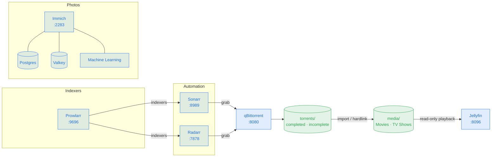

# stream_at_home

[](LICENSE)
[](docker-compose.yml)
[](https://docs.docker.com/engine/install/)
[](#design-decisions)

**A LAN-only self-hosted media stack: one Compose file, nine containers, no cloud, no tunnel, no surprise updates.**

Sonarr, Radarr, Prowlarr, qBittorrent, Jellyfin and Immich wired together on a private Docker network, running on a single small Linux box with one data drive. It was built for a Linux Mint VM, but nothing in it is Mint-specific — any Debian/Ubuntu host with Docker will do.

> **English** | [Magyar](README.hu.md)

This repository is the *infrastructure*: the Compose file, the installer, the folder layout and the operational notes. Secrets, configs, databases and media never enter git.

---

## Highlights

- **Automated pipeline** — Prowlarr feeds indexers to Sonarr/Radarr, which grab through qBittorrent and import into a shared media library.
- **Playback that just works** — Jellyfin scans only the finished `Movies` / `TV Shows` folders, never the download directory.
- **Photos included** — Immich runs alongside with its own Postgres, Valkey and machine-learning container.
- **Reproducible** — every image is pinned to `tag@sha256:…`, so a `pull` six months later gives you the same stack.
- **Idempotent installer** — one script installs Docker, creates the `.env` with a generated database password, prepares the folders, starts everything and waits for health.
- **Predictable storage** — a single `${MEDIA_ROOT}` with a fixed tree keeps hardlinks and atomic moves inside one filesystem.

---

## Stack

| Service | Container | Port | Role |
|---|---|--:|---|
| Sonarr | `sonarr` | 8989 | TV series automation |
| Radarr | `radarr` | 7878 | Movie automation |
| Prowlarr | `prowlarr` | 9696 | Indexer management, syncs to Sonarr/Radarr |
| qBittorrent | `qbittorrent` | 8080 | Download client |
| | | 6881/tcp + udp | Torrent traffic |
| Jellyfin | `jellyfin` | 8096 | Media server for movies and shows |
| Immich | `immich_server` | 2283 | Photo and video library |
| Immich ML | `immich_machine_learning` | — | Smart search / face recognition |
| Immich DB | `immich_postgres` | — | PostgreSQL 14 + VectorChord |
| Immich cache | `immich_redis` | — | Valkey 9 |

Pinned versions (2026-11-23): Sonarr `4.0.20.3014-ls6`, Radarr `7.0.3.10918-ls328`,
Prowlarr `3.0.2.5780-ls169`, qBittorrent `5.3.0_v2.1.2-ls488`,
Jellyfin `12.4ubu2604-ls60`, Immich `v3.4.2`, Valkey `9`, Postgres `14-vectorchord0.4.3-pgvectors0.2.0`.

> Prowlarr 3.x has a known parsing issue with BitHUmen hybrid releases — see [Known issue](#known-issue-prowlarr-3x-and-bithumen).

---

## Architecture



**Flow:** Prowlarr syncs your indexers into Sonarr and Radarr. Those two search, pick a release, and hand the torrent to qBittorrent. Completed downloads land in `${MEDIA_ROOT}/torrents/completed`; the arrs import them (hardlink when possible) into `${MEDIA_ROOT}/media`. Jellyfin only ever sees the finished library. Immich is deliberately independent — its own database, cache and storage tree.

---

## Design decisions

**LAN-only by default.** No Cloudflare Tunnel, no Tailscale, no reverse proxy. Every UI listens on the host's LAN IP. That is a deliberate constraint, not an unfinished feature: these tools were never designed to face the internet, and a homelab does not need to.

**Pin by tag *and* digest.** `latest` tags are banned. Each image line carries an exact tag and `sha256` digest. Upgrades are a conscious edit of that line followed by `pull` and `up -d` — never an accidental side effect of a restart.

**One data root, one view of it.** Everything lives under `MEDIA_ROOT`. Sonarr/Radarr see it as `/data`, qBittorrent sees `torrents/` as `/torrents`, Jellyfin sees `media/` as `/data/media`. Because downloads and the library are on the same filesystem, imports can hardlink instead of copying — instant, space-free, and seed-friendly.

**Containers talk by service name, not host IP.** Prowlarr reaches Sonarr at `http://sonarr:8989`; Sonarr and Radarr reach qBittorrent at `qbittorrent:8080`. Host-published ports are for *you*, not for other containers. (This one is learned the hard way: a container calling `192.168.x.x:8989` often gets nothing, while `sonarr:8989` answers immediately.)

**Idempotent installer, generated secret.** `install.sh` can be re-run safely. It creates `.env` only when missing, generates a 48-character `DB_PASSWORD`, sets `chmod 600`, and never echoes the secret. Non-interactive sudo is supported via `SUDO_PASS` without writing it anywhere.

**Health checks with real dependencies.** Immich waits for Postgres and Valkey to be healthy before starting. Every HTTP service exposes a health check, and the installer polls six endpoints until they answer.

**Bounded logs.** Docker's `json-file` driver is capped at 10 MB × 3 files per container, so a chatty service cannot fill the disk.

---

## Repository layout

```text
.
├── docker-compose.yml    # 9 services, pinned images, health checks, log caps
├── install.sh            # idempotent installer (Docker, .env, folders, start, wait)
├── setup-folders.sh      # creates the data tree under MEDIA_ROOT
├── .env.example          # template; the real .env is generated and gitignored
├── README.md             # this file
├── README.hu.md          # Hungarian version
├── docs/screenshots/     # screenshots used by the README
└── LICENSE               # GPL-3.0
```

---

## Quick start

### Requirements

| | |
|---|---|
| OS | Debian / Ubuntu / Linux Mint (x86_64 or arm64) |
| Docker | Docker CE + Compose plugin — the installer can add them |
| RAM | ~4 GB (Immich ML is the hungry one) |
| Disk | a data drive mounted at `MEDIA_ROOT` |
| Access | sudo |

### 1. Clone and pick a data root

```bash
git clone https://github.com/szentirmaybali/stream_at_home.git
cd stream_at_home
```

The default data root is `/srv/stream-at-home`. Create it once and give your user ownership:

```bash
sudo mkdir -p /srv/stream-at-home
sudo chown "$USER:$USER" /srv/stream-at-home
```

Prefer a different path? Pass it to the installer — it is written into `.env`:

```bash
MEDIA_ROOT=/mnt/media ./install.sh
```

### 2. Install

```bash
chmod +x install.sh setup-folders.sh
./install.sh
```

For a non-interactive run (e.g. over SSH), where sudo cannot prompt:

```bash
SUDO_PASS=your-sudo-password ./install.sh
```

`SUDO_PASS` is used only for sudo authentication. It is not written to `.env`, not logged, and not committed. On a normal terminal just run `./install.sh` and let sudo ask.

### 3. Open the UIs

The installer prints the addresses at the end:

```text
Sonarr       http://<host-ip>:8989
Radarr       http://<host-ip>:7878
Prowlarr     http://<host-ip>:9696
qBittorrent  http://<host-ip>:8080
Jellyfin     http://<host-ip>:8096
Immich       http://<host-ip>:2283
```

### What the installer does

1. Verifies a Debian/Ubuntu-based system and maps the release to the right Docker repo (Mint 22 → `noble`).
2. Installs Docker CE + the Compose plugin from Docker's official repository if missing, and adds your user to the `docker` group.
3. Creates `.env` from `.env.example` with a random `DB_PASSWORD`, then `chmod 600`.
4. Creates any missing directories under `MEDIA_ROOT`.
5. Pulls the pinned images and runs `docker compose up -d --remove-orphans`.
6. Polls all six HTTP endpoints (up to ~3 minutes) and prints a summary with next steps.

---

## First-run checklist

1. **Sonarr / Radarr** — `Settings → General`, copy the API key.
2. **Prowlarr** — add your indexers, then `Settings → Apps` and add Sonarr and Radarr **using container URLs**:
   - Sonarr: `http://sonarr:8989`
   - Radarr: `http://radarr:7878`

   After sync, the indexers appear in both arrs automatically.
3. **qBittorrent** — change the default `admin` / `admin` login immediately. Set the default save path to `/torrents/completed`, incomplete downloads to `/torrents/incomplete`.
4. **Sonarr / Radarr download client** — add qBittorrent at `qbittorrent:8080`, and use `/data/torrents/completed` / `/data/torrents/incomplete` as the paths (the same files, seen through a different mount).
5. **Sonarr / Radarr root folders** — `/data/media/TV Shows` and `/data/media/Movies`.
6. **Jellyfin** — add libraries `/data/media/Movies` and `/data/media/TV Shows`. Do not point it at `torrents/`.
7. **Immich** — create the admin account on port `2283`.

> **Path mapping cheat sheet**
>
> | Same file on disk | qBittorrent sees | Sonarr / Radarr see | Jellyfin sees |
> |---|---|---|---|
> | `${MEDIA_ROOT}/torrents/completed` | `/torrents/completed` | `/data/torrents/completed` | — |
> | `${MEDIA_ROOT}/media/Movies` | — | `/data/media/Movies` | `/data/media/Movies` |
> | `${MEDIA_ROOT}/media/TV Shows` | — | `/data/media/TV Shows` | `/data/media/TV Shows` |

---

## Data layout

```text
${MEDIA_ROOT}/
├── appdata/
│   ├── sonarr/
│   ├── radarr/
│   ├── prowlarr/
│   ├── qbittorrent/
│   └── jellyfin/
├── media/
│   ├── Movies/
│   └── TV Shows/
├── torrents/
│   ├── completed/
│   └── incomplete/
└── immich/
    ├── library/        # uploaded photos and videos
    ├── postgres/       # Immich database
    └── model-cache/    # ML models
```

`appdata/` holds every service's config and SQLite database. Back it up; treat it as the crown jewels.

---

## Day-2 operations

### Status and logs

```bash
set -a; . ./.env; set +a   # MEDIA_ROOT a .env-ből
docker compose ps
docker compose logs --tail=100 sonarr
docker compose logs -f immich-server
docker compose restart qbittorrent
sudo ss -tulpn | grep -E '8989|7878|9696|8080|8096|2283'
df -h "$MEDIA_ROOT"
```

### Updating an image

Digest pinning means nothing updates by itself. Upgrades are explicit:

```bash
# 1. look up the new tag and digest
docker buildx imagetools inspect lscr.io/linuxserver/sonarr:<new-tag>
# 2. edit the image: line in docker-compose.yml (tag@sha256:…)
# 3. apply
docker compose pull
docker compose up -d
```

### Backup

```bash
set -a; . ./.env; set +a
docker compose down
mkdir -p backups
tar czf "backups/stream-$(date +%F).tar.gz" -C "$MEDIA_ROOT" appdata immich
cp .env backups/
docker compose up -d
```

`appdata/` and `immich/` are the important parts (configs, Immich library and its database). `media/` and `torrents/` can be re-acquired, so they are usually left out of the small backup; add them if you want a full snapshot. `backups/` and `.env` are gitignored.

> Losing `DB_PASSWORD` means losing access to the Immich database. Keep a copy of `.env` somewhere safe, separate from the host.

### Restore

```bash
set -a; . ./.env; set +a
docker compose down
tar xzf backups/stream-YYYY-MM-DD.tar.gz -C "$MEDIA_ROOT"
cp backups/.env .env && chmod 600 .env
docker compose up -d
```

---

## Security notes

- **LAN only.** Nothing is forwarded to the internet by this repo. The `6881` port is open on the host for torrent traffic; do not port-forward it unless you actually need WAN peers.
- **No default passwords.** The database password is generated per install. qBittorrent's `admin` / `admin` must be changed on first login — the installer cannot do it for you.
- **Secrets stay out of git.** `.env` is gitignored and `chmod 600`; `.env.example` contains placeholders only.
- **If you ever expose a UI,** put an authenticating proxy in front of it (Cloudflare Access, Authelia, Traefik + forward-auth). None of these apps are safe to publish raw.
- **Containers run as your UID/GID** (`PUID`/`PGID`, default `1000:1000`), so media files stay owned by you rather than root.

---

## Known issue: Prowlarr 3.x and BitHUmen

Prowlarr `3.0.2` mis-parses BitHUmen **hybrid** releases (the plain and hybrid variants get merged during parsing). If a search returns errors for those releases:

- switch to the proven `2.7.0` or `2.6.5`: change the `prowlarr` `image:` line to `lscr.io/linuxserver/prowlarr:2.7.0`, then `docker compose pull && docker compose up -d prowlarr`; or
- filter hybrid releases at the indexer level.

nCore downloads are not affected.

---

## Troubleshooting

| Symptom | Likely cause | Fix |
|---|---|---|
| `permission denied` on `docker compose` | docker group not active in this shell | `newgrp docker`, or log out and back in |
| `MEDIA_ROOT is not set` when running compose manually | no `.env` yet | `cp .env.example .env`, edit `MEDIA_ROOT`, then `docker compose config -q` |
| Sonarr/Radarr cannot reach qBittorrent | host IP used instead of service name | use `qbittorrent:8080` |
| Prowlarr app test fails | same, or wrong API key | use `http://sonarr:8989` / `http://radarr:7878` and paste the API key |
| Immich keeps restarting | Postgres not healthy or wrong `DB_PASSWORD` | `docker compose logs database`, check `.env` was not changed after first start |
| qBittorrent downloads fill the disk | incomplete path not set | set `/torrents/incomplete`, keep completed imports hardlinked |
| Jellyfin shows nothing | library points to `torrents/` or empty media folders | add `/data/media/Movies` and `/data/media/TV Shows` |

---

## Screenshots

<!--
Drop the images into docs/screenshots/ and uncomment this section.
Suggested files and captions are listed in docs/screenshots/README.md.

| Jellyfin | Sonarr |
|---|---|
|  |  |

| Prowlarr indexers | Immich timeline |
|---|---|
|  |  |
-->

*Screenshots are on the way — the stack is documented first, the pretty pictures second.*

---

## License

[GPL-3.0](LICENSE). Use it, fork it, learn from it.
